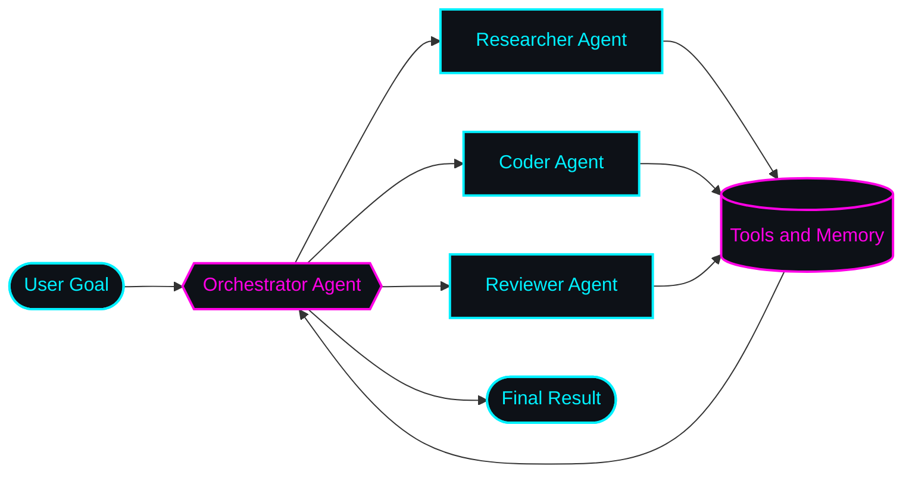

<!-- ================================================================
     PARSA • CYBER PROFILE README
     Repo must be named exactly: Parsabehroozi/Parsabehroozi (public)
     Search for "TODO" to find the placeholders you should replace.
     ================================================================ -->

<div align="center">


<a href="https://github.com/Parsabehroozi">
  
</a>

<p><sub>سلام! من پارسا هستم — روی هوش مصنوعی، پایتون و سیستم‌های چندعاملی کار می‌کنم 🤖</sub></p>


</div>

<br/>

## `> about_me.py`

```python
class Parsa:
    handle     = "Parsabehroozi"
    focus      = ["LLM Applications", "Multi-Agent Systems", "Automation"]
    stack      = ["Python", "LangGraph", "CrewAI", "AutoGen", "FastAPI", "PyTorch"]
    currently  = "Building autonomous agents that plan, collaborate and ship"
    philosophy = "Agents should reason, cooperate, and stay under control."

    def say_hi(self) -> str:
        return "Let's build something intelligent. ⚡"
```

- 🧠 Working on **AI agents that collaborate** — planners, coders, reviewers and tool-using specialists
- 🐍 Writing clean, typed, production-minded **Python**
- 🔬 Exploring **orchestration patterns**, agent memory, tool calling and evaluation
- 🤝 Open to collaborating on **open-source AI & agent projects**

<br/>

## `> tech_arsenal.sh`

<div align="center">


<br/><br/>

<a href="https://skillicons.dev">
  
</a>

</div>

| Layer | Tools |
|:--|:--|
| **Language** | Python |
| **Agent frameworks** | LangGraph · CrewAI · AutoGen · LangChain |
| **LLM providers** | Claude · OpenAI · open-source models via Hugging Face |
| **Backend & infra** | FastAPI · Docker · Redis · PostgreSQL |
| **ML** | PyTorch · scikit-learn · NumPy · Pandas |

<br/>

## `> multi_agent_architecture.mermaid`

How I usually think about a multi-agent system:



<br/>

## `> featured_projects/`

<!-- TODO: replace REPO_NAME_1/2/3 with your real repository names, then delete this comment -->

<div align="center">

<a href="https://github.com/Parsabehroozi/REPO_NAME_1">
  
</a>
<a href="https://github.com/Parsabehroozi/REPO_NAME_2">
  
</a>
<br/>
<a href="https://github.com/Parsabehroozi/REPO_NAME_3">
  
</a>

</div>

<br/>

## `> github_stats.json`

<div align="center">


<br/>


<br/><br/>


</div>

<br/>

## `> contribution_snake.svg`

<div align="center">

<picture>
  <source media="(prefers-color-scheme: dark)" srcset="https://raw.githubusercontent.com/Parsabehroozi/Parsabehroozi/output/github-contribution-grid-snake-dark.svg" />
  <source media="(prefers-color-scheme: light)" srcset="https://raw.githubusercontent.com/Parsabehroozi/Parsabehroozi/output/github-contribution-grid-snake.svg" />
  
</picture>

</div>

<!-- The snake appears after you add .github/workflows/snake.yml and run it once. -->

<br/>

## `> roadmap.md`

- [x] Python fundamentals → production-style projects
- [x] LLM apps with tool calling
- [ ] Reliable multi-agent orchestration (planning, handoff, recovery)
- [ ] Agent evaluation & observability
- [ ] Open-source multi-agent framework / toolkit

<br/>

## `> connect.sh`

<div align="center">

<!-- TODO: replace the placeholders below with your real links -->
<a href="https://github.com/Parsabehroozi"></a>
<a href="mailto:YOUR_EMAIL"></a>
<a href="https://www.linkedin.com/in/YOUR_LINKEDIN"></a>
<a href="https://t.me/YOUR_TELEGRAM"></a>

<br/><br/>


</div>
